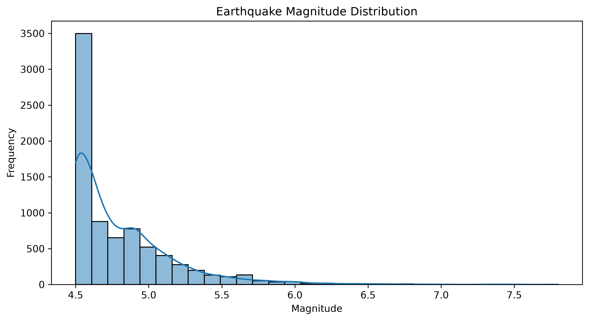
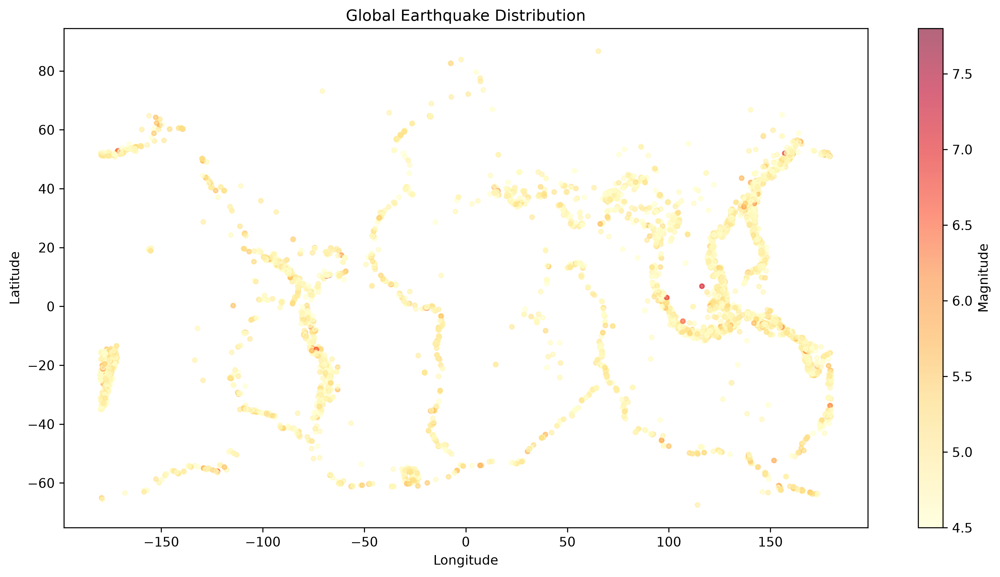
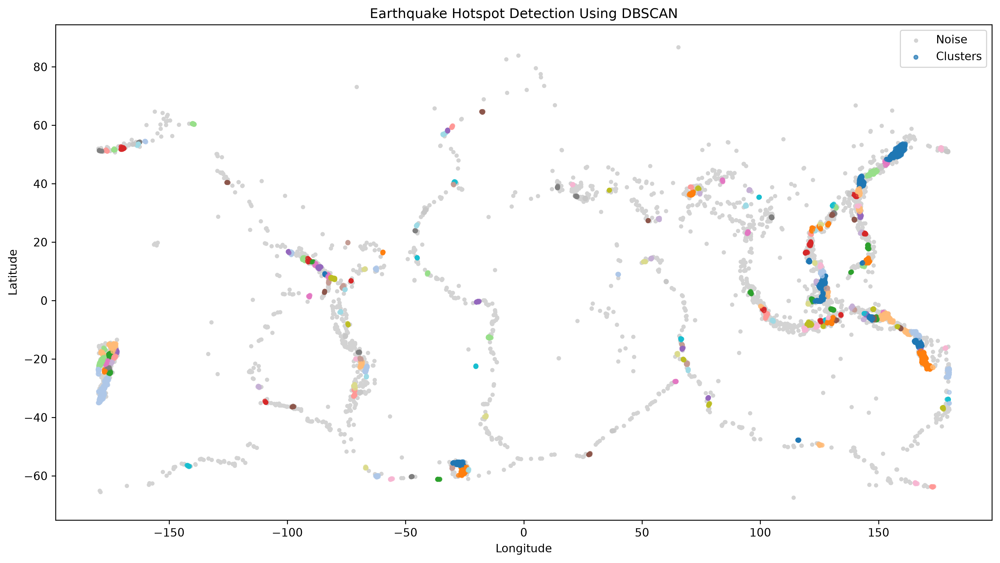
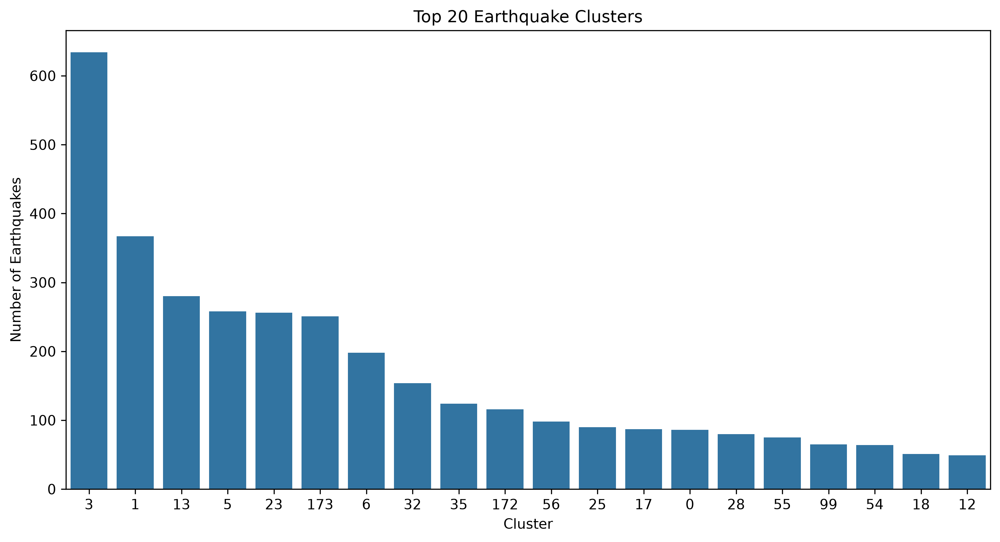
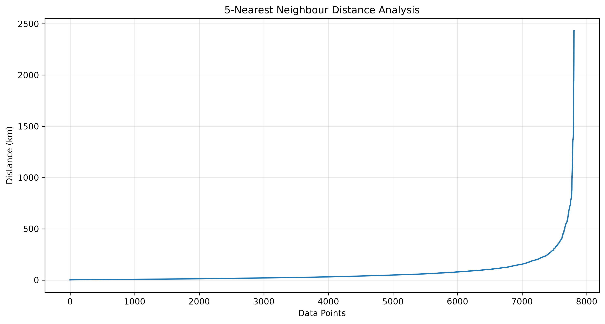

# Global Earthquake Hotspot Detection Using DBSCAN

## Project Overview

This project applies Density-Based Spatial Clustering of Applications with Noise (DBSCAN) to identify geographical clusters of earthquake epicentres and detect isolated seismic events.

## Objective

To analyse global earthquake locations and identify spatial concentrations using density-based clustering.

## Dataset

Source: USGS Earthquake Catalog

https://earthquake.usgs.gov/fdsnws/event/1/

The dataset contains earthquake information such as:
- Latitude
- Longitude
- Magnitude
- Depth
- Time
- Location

## Technologies Used

- Python
- Pandas
- NumPy
- Matplotlib
- Seaborn
- Scikit-learn
- Folium
- Jupyter Notebook

## Project Workflow

1. Dataset Loading
2. Data Cleaning
3. Exploratory Data Analysis
4. Geographical Feature Preparation
5. Haversine Distance Calculation
6. K-Distance Analysis
7. Epsilon Selection
8. DBSCAN Clustering
9. Noise Detection
10. Geographical Visualization
11. Cluster Analysis

## Model Configuration

- Algorithm: DBSCAN
- Distance Metric: Haversine
- Epsilon: 50 km
- Min Samples: 5

## Model Results

- Total Earthquakes: 7805
- Number of Clusters: 207
- Noise Points: 2274
- Noise Percentage: 29.14%

## Visualizations

### Earthquake Magnitude Distribution

### Global Earthquake Distribution

### DBSCAN Clusters

### Cluster Distribution

### K-Distance Analysis

## Interactive Map

Open outputs/earthquake_hotspots.html to explore earthquake locations interactively.

## How to Run

1. Clone this repository.
2. Install dependencies:

   pip install -r requirements.txt

3. Download the earthquake dataset from USGS.
4. Place earthquakes.csv inside the data folder.
5. Open DBSCAN_Analysis.ipynb.
6. Run all cells.

## Important Limitations

- DBSCAN identifies spatial patterns in historical earthquake records.
- It does not predict future earthquakes.
- Geographical clusters do not independently establish earthquake hazard levels.
- Results depend on the selected Epsilon and Min Samples parameters.
- Events are clustered spatially, not temporally.

## Author

Garv Dubey
